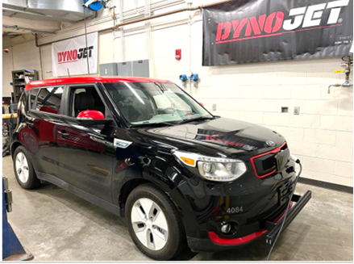
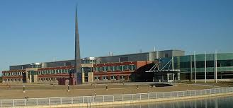
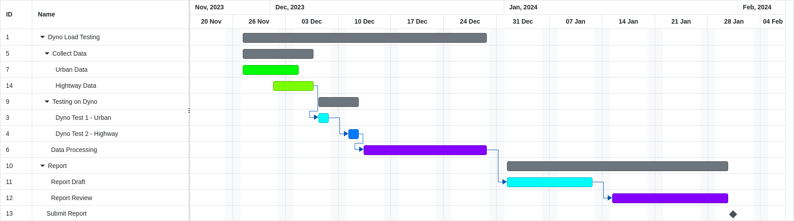
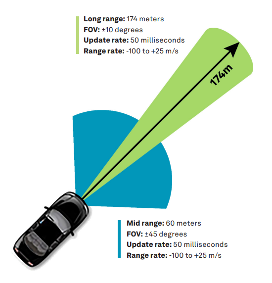
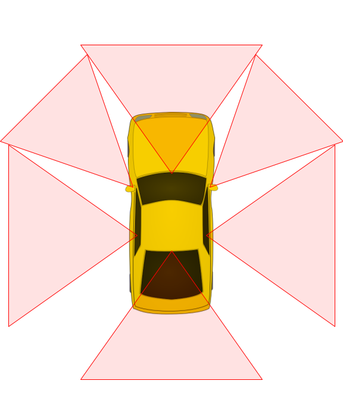

# **Table Of Contents**

| Location                          | 3   |
|-----------------------------------|-----|
| Dates of Completion               | 3   |
| Test Summary                      | 4   |
| Vehicle and Technology Background | 5   |
| Data Collection Process           | 8   |

> ​​
>
> ​​

# **Location** 

Energy Efficient Autonomous Vehicles (EEAV) Lab

G-114, College of Engineering and Applied Sciences, Western Michigan University,

4601 Campus Dr, Kalamazoo, MI 49008

# **Dates of Completion** 

| **Drive Cycle** | **Date Range**                  | **Description**                                     |
|-----------------|---------------------------------|-----------------------------------------------------|
| 2               | Between 09/25/2023 and 12/31/23 | Computation load reduction observed on chassis dyno |

# **Test Summary**

Our test plan consists of gathering data on the power consumption (W) of an autonomous vehicle that is instrumented with infrastructure-based sensors and technologies. The vehicle will be run on a chassis dynamometer with a standard drive cycle, with the primary objective of proving that these sensors result in a reduced computational load compared to traditional perception systems. The vehicle instrumentation and drive cycles will be discussed below.

# 

# **Vehicle and Technology Background** 

The vehicle used will be the 2015 Kia Soul. The list of the sensors and capabilities are listed below:

## Instrumentation

- **1 x Polysync Drivekit**

  - Enables drive-by-wire capability on the vehicle.

- **1 x Aptiv ESR 2.5 24V Radar**

  - Object detection and accuracy in position and movement determination.

  - Specifications:

    1.  Power Consumption: Max. 18 W

> 
>
> More specific details can be found at [<u>https://autonomoustuff.com/products/aptiv-esr-2-5-24v</u>](https://autonomoustuff.com/products/aptiv-esr-2-5-24v)

- 

<!-- -->

- **1 x Ouster OS1 Mid-Range Lidar**

  - Create 3D mappings of its environment.

  - Specs:

    1.  Range: 90-200m

    2.  Vertical FOV: 45°

    3.  Resolution: 128 channels

    4.  Max points per second: 5.2 M

    5.  Power Consumption: 14-20 W (22 W peak at startup, 28 W peak if operating at -40 °C)

- **1 x Ouster OS2 Long-Range Lidar**

  - Create 3D mappings of its environment.

  - Specs:

    1.  Range: 200-400m

    2.  Vertical FOV: 22.5°

    3.  Resolution: 128 channels

    4.  Max points per second: 2.6 M

    5.  Power Consumption: 18 - 24 W (28 W peak at startup, 30 W peak if operating below 10 °C)

- **6 x Baseler ace - acA1440-220uc Cameras**

  - Visualizes what is around the car.

  - 1 x Front facing

  - 1 x Front left facing

  - 1x Front right facing

  - 1 x Left facing

  - 1 x Right facing

  - 1 x Rear facing

  - Specs:

    1.  Sony IMX273 CMOS sensor

    2.  Resolution: 1440 x 1080p (1.6MP)

    3.  Frame Rate: 10 fps

    4.  Power Requirements (typical): 3.3W

> 

- **2 x SwiftNav Duro Inertial GNSS receiver**

  - Gives highly accurate location of vehicle, used for localization.

  - Specs:

    1.  GNSS + RTK + IMU technologies

    2.  Horizontal Position Accuracy: 0.40 m

    3.  Power Requirements: 5.0 W

- **Radar Retroreflectors (RRs)**

  - Octahedral Boat Radar Retroreflectors

  - 12” size

- **Chip-Enabled Raised Pavement Markers (CERPMs)**

  - In-Vehicle CERPM receiver

  - 8 x 3 cm

- **Cellular Offloading**

  - Offloads data from vehicle to the cloud for computation

  - Cellular modem with 6 antennas using redundant cellular networks

# **Data Collection Process** 

The data collection process will involve multiple steps.

## CERPMs

The data for CERPMs will be collected by placing the 10 CERPMs at 40 feet separation with one CERPM on each side of the road, i.e., 5 CERPMs on each side of the road. With the receiver collecting the transmitted information the vehicle will drive through and the received data will be collected in a rosbag. The collected data includes the individual CERPM IDs and their respective geolocation data.

## Radar Retroreflector

This data will be collected similarly to the CERPMs. Boat radar retroreflectors which are essentially octahedral type aluminum radar reflectors will be placed on each side of the road at a separation of 40 feet. Rosbag will be recorded while the vehicle is driving through. The rosbag includes the radar detection data such as the object position and radar signal power for the radar retroreflectors.

## Lidar, Radar, Cameras, GPS+RTK, and Weather Sensors

The vehicle will be driven around for 30 minutes while all the remaining sensors are running. The data from these sensors will be collected in another rosbag. From the Lidar, pointcloud data of the environment is recorded. Radar will give us the position and return power of detected objects. Camera gives us images. GPS+RTK gives geo position of the vehicle. And from the weather sensor we will get the precipitation, road temperature, icey conditions, etc.

## Drive Cycle

The drive cycle that is to be used on the dyno is the EPA Urban Dynamometer Driving Schedule (UDDS) drive cycle. Sensor data will be retrieved from previously recorded rosbags. The CERPM and Radar Retroreflector rosbags will be looped over while the other rosbag will just be run since it contains 30 minutes of data.

A PID trace follower will be used to control the speed of the vehicle based on the UDDS drive cycle. The voltage, current, and power will be recorded at the vehicle 12V battery using a Fluke Power Analyzer 434 Series II. The SOC will also be recorded for the entire drive cycle as an alternate data point.

### Test 1

For the first test, due to the large amount of data that has to be processed two separate computers will be used. Both will be powered by the vehicle on-board battery. All sensor data will be processed on these two computers. The two computers will communicate with each other using ROS and ethernet.

### Test 2

For the second test, we will remove one of the two computers from the vehicle and only the computer (streamer computer) that is inside the vehicle will be powered by the vehicle’s battery. The other computer (node computer) will be powered by standard wall power. Camera images will be offloaded to the node computer using the cellular network. The node computer processes this data and returns the result to the vehicle for use.
