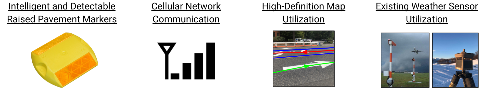

**<u>Infrastructure Enabled Energy Efficient Autonomous Vehicles</u>**

**PROJECT OVERVIEW**

<table>
<colgroup>
<col style="width: 100%" />
</colgroup>
<thead>
<tr class="header">
<th>
Our team is developing and demonstrating autonomous vehicle sensing and computation technologies that provide improved energy efficiency and improved safety. Current vehicle automation systems consume a large amount of computational resources and energy due to on-board sensor processing. The infrastructure technologies developed in this project provide a method for autonomous vehicles to interact with the driving environment in a more natural way. Rather than having autonomous vehicle sensors evaluate cues used by human drivers, the vehicle can now interact with the road in ways that make intuitive sense for computers: direct data transfer.

This project uses intelligent and radar detectable raised pavement markers (RPMs), cellular network computational offloading, high-definition map data transfer, and existing weather sensors to upload a high-quality perception of the driving environment directly to the vehicle. Each of these infrastructure technologies are fundamentally in place currently and only require minor updates such as cell phone signal boosting and RPM replacement as part of regular maintenance. By uploading the driving environment characteristics directly to the vehicle, safer driving decisions can be made as well as a reduction in computational load equivalent to 7% of the total range for current light-duty electric vehicles.
</th>
</tr>
</thead>
<tbody>
</tbody>
</table>

**PROJECT TIMELINE**

|  |
|-----------------------------------------------------------------------------------------------|

**STAKEHOLDERS**

|  |
|-----------------------------------------------------------------------------------------------|
