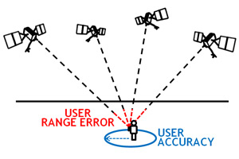

**GPS**

Localization is the methodology within the perception subsystem to precisely estimate the position of the ego vehicle in the world. A Global Navigation Satellite System (GNSS) is a technology used for vehicle positioning on land. GNSS data provides the absolute position of a receiver with respect to a fixed reference and consists of a set of satellites orbiting approximately 20,000 km from the earth’s surface. However, these positioning sensors suffer from several drawbacks. The precision of the GNSS data depends on the positioning of the satellites and the information is usually received at 10 Hz. This inconsistency can cause an accident in AV applications due to jumps and deviations in the data.

**How accurate are GPS ?**

It depends. GPS satellites broadcast their signals in space with a certain accuracy, but what you receive depends on additional factors, including satellite geometry, signal blockage, atmospheric conditions, and receiver design features/quality.

For example, GPS-enabled smartphones are typically accurate to within a 4.9 m (16 ft.) radius under open sky. However, their accuracy worsens near buildings, bridges, and trees.

High-end users boost GPS accuracy with dual-frequency receivers and/or augmentation systems. These can enable real-time positioning within a few centimeters, and long-term measurements at the millimeter level.

**GPS RTK**

In practice, RTK systems use a single base-station receiver and a number of mobile units. The base station re-broadcasts the phase of the carrier that it observes, and the mobile units compare their own phase measurements with the one received from the base station. There are several ways to transmit a correction signal from base station to mobile station. The most popular way to achieve real-time, low-cost signal transmission is to use a radio modem, typically in the UHF Band. In most countries, certain frequencies are allocated specifically for RTK purposes. Most land-survey equipment has a built-in UHF-band radio modem as a standard option. RTK provides accuracy enhancements up to about 20 km from the base station.

This allows the units to calculate their relative position to within millimeters, although their absolute position is accurate only to the same accuracy as the computed position of the base station. The typical nominal accuracy for these systems is 1 centimetre ± 2 parts-per-million (ppm) horizontally and 2 centimetres ± 2 ppm vertically.

**Procedure**

The EEAV Lab research vehicle is equipped with SwiftNav GPS sensors. A Hard Piksi and an Inertial Hard Piksi. The difference between the two is that the Piksi Duro Inertial has an IMU sensor and has the configuration to merge GPS and IMU data to obtain a better location. A typical multi band GNSS receiver has an accuracy 2.5 m in the horizontal axis using CEP 50 (or 1.7 times the horizontal accuracy). Therefore, to obtain centimeter accuracy, RTK corrections are required. Below we will present the procedure carried out to obtain a precision of 2-4 centimeters.

1.  The cloud based service subscription was purchased to obtain the fixes with the L1/L2 bandwidths (typically used for North America) via the internet.

2.  A modem with a sim card was installed to receive internet and transmit it to the sensors through a switch.

3.  The reference sensor was configured to receive the corresponding corrections. Accuracy immediately dropped from 0.5-1.5 meters to less than 10 cm.

4.  To further reduce accuracy, the Piksi Duro Inertial's merge setting was enabled to merge the corrected GPS data with IMU data. Accuracy dropped to less than 4 cm.
